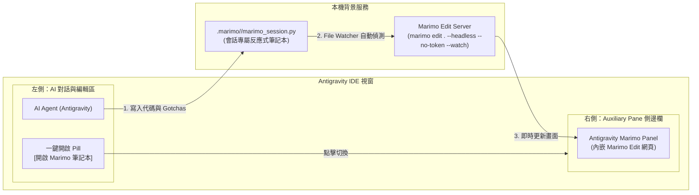

# 🧪 Antigravity Marimo Reactive Notebook Extension

[](https://github.com/arco651749/antigravity-marimo)
[](https://marimo.io)
[](https://python.org)
[](LICENSE)

**Antigravity Marimo** 是專為 Google Antigravity Agentic IDE 打造的反應式筆記本深度整合外掛。  
在右側輔助視窗（Auxiliary Side Pane）中直接內嵌即時運行的 **Marimo Edit** 介面，實現**「左邊對話改代碼、右邊 50ms 自動熱重載、零切換視窗點擊測試」**的沉浸式開發閉環。

---

## ✨ 核心特色

1. **零視窗切換（Zero Context Switching）**：
   * 告別「AI 開了伺服器卻要人類手動開 Chrome、縮放視窗」的割裂體驗。
   * 透過 Antigravity 原生 Sidecar 機制，直接在 IDE 內部開闢專屬面板。
2. **極速熱重載（50ms Hot Reloading）**：
   * 背景啟動 `marimo edit --watch --no-token`。
   * 無論是 AI 修改代碼還是你在本地儲存檔案，右側畫面毫秒級自動刷新。
3. **活文檔知識沉澱（Living Executable Documentation）**：
   * 每個模組遵循「三區塊規範」：
     * 📝 **踩坑紀錄 (`mo.md`)**：記錄 Windows UTF-8、API 限制、報錯原因，防止 AI 越改越回去。
     * ⚙️ **純函式邏輯**：乾淨無副作用，方便外部 import。
     * 🎛️ **自助互動面板 (`mo.ui`)**：配置滑桿、文字框或上傳按鈕，使用者免 AI 即可自主運行。
4. **一鍵匯出生產腳本（Export to Script）**：
   * 借助 Marimo 底層 DAG（有向無環圖）的拓撲排序，一鍵輸出乾淨無裝飾器的獨立 Python 腳本。
5. **目錄工作區毫秒級切換（Instant Multi-Notebook Switching）**：
   * 原生目錄工作區架構，常駐單一伺服器核心。在下拉選單切換不同筆記本時零重啟、零等待（0.1 秒即時跳轉）。

---

## 🏗️ 系統架構



---

## 📁 專案結構

```
antigravity-marimo/
├── plugin.json                 # Antigravity Plugin 元資料與啟動指令
├── assets/
│   └── logo.svg                # 模組專屬 SVG 圖示
├── sidecars/
│   └── panel/
│       ├── sidecar.json        # 宣告 Auxiliary Pane 側邊欄入口
│       ├── main.mjs            # 守護進程：自動調度 Marimo 背景服務與筆記本掃描
│       ├── index.html          # 側邊欄介面 (狀態燈、筆記切換下拉選單、重載按鈕)
│       └── package.json
├── skills/
│   └── marimo-notebook/
│       └── SKILL.md            # AI 專屬技能：掌握活文檔架構與踩坑紀錄規範
├── toolbox/
│   └── agent_toolbox.py        # 工作區開箱即用示範筆記本
└── README.md
```

---

## 🚀 快速安裝與啟用

### 1. 安裝需求
* Python `>= 3.10`
* Marimo：
  ```powershell
  python.exe -m pip install --upgrade marimo
  ```

### 2. 安裝外掛至 Antigravity
將此倉庫複製到全域 Antigravity Plugins 目錄：
```powershell
# 複製至全域 plugins 目錄
Copy-Item -Path ".\antigravity-marimo" -Destination "$HOME\.gemini\config\plugins\antigravity-marimo" -Recurse -Force
```

### 3. 在 Antigravity 中開啟
在對話中點擊專屬膠囊按鈕：
```markdown
[開啟 Marimo 筆記本](sidecar://antigravity-marimo/panel/)
```

---

## 📐 Cell 三區塊設計標準 (Three-Block Pattern)

為確保筆記本符合 Marimo 的 DAG 規則並具備高度復用性，請遵循以下樣板：

```python
import marimo as mo

# [區塊 1] 踩坑紀錄與說明
@app.cell
def _(mo):
    mo.md(
        r"""
        ---
        ## 📌 模組：文字編碼清洗與統計器
        * **最後修訂**：2026-10-15
        * **踩坑紀錄 (Gotchas)**：Windows 預設 cp950 常引發 UnicodeEncodeError，強制使用 UTF-8。
        * **修改原因**：快速清洗文字並統計行數。
        """
    )
    return

# [區塊 2] 核心純函式邏輯
@app.cell
def _():
    def clean_text_data(raw_text: str) -> dict:
        lines = [line.strip() for line in raw_text.splitlines() if line.strip()]
        return {"total_lines": len(lines), "preview": lines[:5]}
    return (clean_text_data,)

# [區塊 3] 自助互動操作面板
@app.cell
def _(clean_text_data, mo):
    txt_input = mo.ui.text_area(value="測試文字", label="輸入文字")
    btn_exec = mo.ui.run_button(label="🚀 執行處理")

    res = clean_text_data(txt_input.value) if btn_exec.value else None

    mo.vstack([
        mo.md("### 🎛️ 自助操作台"),
        txt_input,
        btn_exec,
        mo.ui.json(res) if res else mo.md("_請點擊執行_")
    ])
    return btn_exec, res, txt_input
```

---

## 📤 一鍵匯出為獨立生產腳本

隨時可將筆記本中的邏輯匯出為可獨立執行的乾淨 Python 程式：
```powershell
python.exe -m marimo export script .marimo/<session_id>/marimo_session.py -o standalone_script.py
```

---

## 🤝 即時雙向結對交互 (`marimo pair`)

除了檔案修改熱重載，Agent 還可透過 Marimo 原生 `marimo pair` 協議與使用者進行即時 Live 結對互動：
* **探測 Live 會話**：`marimo pair notebook list --url http://127.0.0.1:<port>`
* **執行暫存代碼 / 彈窗提示**：`marimo pair execute --url http://127.0.0.1:<port> --session <id> -c "import marimo as mo; mo.status.toast('處理完成！')"`
* **Code-Mode 單元格動態增刪改查**：支援透過 `marimo._code_mode` 程式化操作 Cell 與反應式計算 DAG。

---

## 📄 License
本專案採用 [MIT License](LICENSE) 授權。
