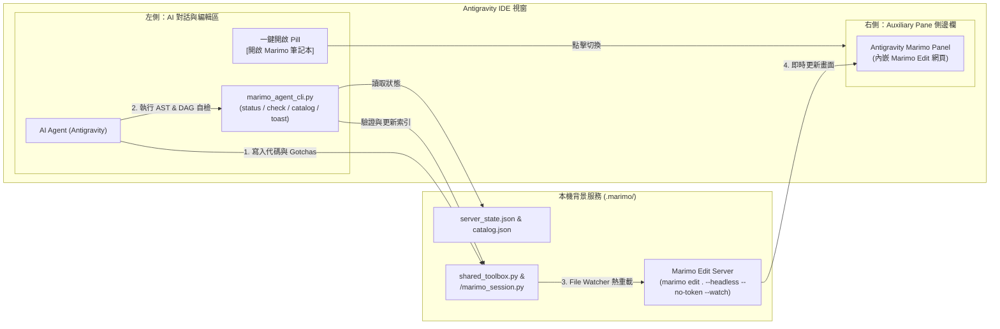

# 🧪 Antigravity Marimo Reactive Notebook Extension (Closed-Loop Agent Edition)

[](https://github.com/arco651749/antigravity-marimo)
[](https://marimo.io)
[](https://python.org)
[](LICENSE)

**Antigravity Marimo** 是專為 Google Antigravity Agentic IDE 打造的反應式筆記本深度整合外掛。  
在右側輔助視窗（Auxiliary Side Pane）中直接內嵌即時運行的 **Marimo Edit** 介面，並配備 **AI Agent 閉環自檢 CLI (`marimo_agent_cli.py`)**，實現**「左邊對話寫代碼 + 自動 DAG 靜態驗證、右邊 50ms 自動熱重載、零切換視窗點擊測試」**的工程閉環。

---

## ✨ 核心特色

1. **AI Agent 閉環自檢與零盲改（Closed-Loop Verification）**：
   * 內建 `marimo_agent_cli.py`，提供 `status`（冷啟動確保與狀態探測）、`check`（UTF-8 BOM 自動剝除 + AST 尾端錨點防護 + `marimo check` DAG 驗證）、`catalog`（跨會話函式 AST 索引）與 `toast`（無 Live Session 時優雅降級的通知）。
2. **雙層知識記憶架構（Session Isolation + Shared Toolbox）**：
   * **會話隔離層 (`.marimo/<session_id>/marimo_session.py`)**：每個對話視窗擁有獨立開發空間，互不污染。
   * **專案共用工具箱 (`.marimo/shared_toolbox.py`)**：跨會話永久留存的專案級核心工具庫，在下拉選單固定置頂，解決跨會話知識孤島問題。
3. **確定性狀態同步与智慧虛擬環境偵測（Deterministic State & Venv Discovery）**：
   * 自動寫入 `.marimo/server_state.json` 與 `.marimo/catalog.json`，並優先偵測工作區 `.venv` / `venv` 虛擬環境中的 Marimo。
4. **活文檔知識沉澱（Living Executable Documentation）**：
   * 每個模組遵循「三區塊規範」：
     * 📝 **踩坑紀錄 (`mo.md`)**：記錄 Windows UTF-8、API 限制、報錯原因，防止 AI 越改越回去。
     * ⚙️ **純函式邏輯 (`@app.function` / `@app.cell`)**：乾淨無副作用，方便外部 import。
     * 🎛️ **自助互動面板 (`mo.ui`)**：配置滑桿、文字框或按鈕，使用者免 AI 即可自主運行。

---

## 🏗️ 系統架構



---

## 📁 專案結構

```
antigravity-marimo/
├── plugin.json                 # Antigravity Plugin 元資料與啟動指令
├── assets/
│   └── logo.svg                # 模組專屬 SVG 圖示
├── sidecars/
│   └── panel/
│       ├── sidecar.json        # 宣告 Auxiliary Pane 側邊欄入口
│       ├── main.mjs            # 守護進程：多專案端口常駐、venv 偵測與 server_state.json 持久化
│       ├── index.html          # 側邊欄介面 (狀態燈、共用工具箱置頂選單、重載按鈕)
│       └── package.json
├── skills/
│   └── marimo-notebook/
│       ├── SKILL.md            # AI 專屬技能：閉環 SOP、三區塊架構與踩坑紀錄規範
│       └── scripts/
│           └── marimo_agent_cli.py # AI 閉環自檢與跨會話索引 CLI 工具
├── toolbox/
│   └── agent_toolbox.py        # 工作區開箱即用示範筆記本
└── README.md
```

---

## 🚀 快速安裝與啟用

### 1. 安裝需求
* Python `>= 3.10`
* Marimo：
  ```powershell
  python.exe -m pip install --upgrade marimo
  ```

### 2. 安裝外掛至 Antigravity
將此倉庫複製到全域 Antigravity Plugins 目錄：
```powershell
Copy-Item -Path ".\antigravity-marimo\*" -Destination "$HOME\.gemini\config\plugins\antigravity-marimo" -Recurse -Force
```

### 3. 在 Antigravity 中開啟
在對話中點擊專屬膠囊按鈕：
```markdown
[開啟 Marimo 筆記本](sidecar://antigravity-marimo/panel/)
```

---

## 📐 Cell 三區塊設計標準 (Safe Three-Block Pattern)

為確保筆記本符合 Marimo 的 DAG 規則並具備高度復用性，請遵循以下樣板：

```python
# [區塊 1] 踩坑紀錄與說明
@app.cell(hide_code=True)
def _(mo):
    mo.md(
        r"""
        ---
        ## 📌 模組：文字編碼清洗與統計器
        * **最後修訂**：2026-10-16
        * **踩坑紀錄 (Gotchas)**：
          1. Windows 預設 cp950 常引發 UnicodeEncodeError，強制使用 UTF-8。
          2. Marimo Cell 內設定 stdout 須加上 `if hasattr(sys.stdout, "reconfigure"):`。
        * **修改原因**：快速清洗文字並統計行數。
        """
    )
    return


# [區塊 2] 核心純函式邏輯 (推薦使用 @app.function)
@app.function
def clean_text_data(raw_text: str) -> dict:
    """純 Python 函式：清理空白行並回傳統計結果。"""
    lines = [line.strip() for line in raw_text.splitlines() if line.strip()]
    return {"total_lines": len(lines), "preview": lines[:5]}


# [區塊 3] 自助互動操作面板 (展示層結尾保持 return 為空，避免 DAG 名稱碰撞)
@app.cell
def _(mo):
    txt_input = mo.ui.text_area(value="測試文字", label="輸入文字")
    btn_exec = mo.ui.run_button(label="🚀 執行處理")
    return btn_exec, txt_input


@app.cell
def _(btn_exec, clean_text_data, mo, txt_input):
    _res = clean_text_data(txt_input.value) if btn_exec.value else None
    mo.vstack([
        mo.md("### 🎛️ 自助操作台"),
        txt_input,
        btn_exec,
        mo.ui.json(_res) if _res else mo.md("_請點擊執行_")
    ])
    return
```

---

## 🛠️ AI Agent 閉環 CLI 工具 (`marimo_agent_cli.py`)

```powershell
$cli = "$HOME\.gemini\config\plugins\antigravity-marimo\skills\marimo-notebook\scripts\marimo_agent_cli.py"

# 1. 確保冷啟動檔案存在並查詢伺服器與 Live Session 狀態
python.exe -X utf8 $cli status --workspace "." --session "<conversation_id>"

# 2. 執行 BOM 清理 + AST 尾端防護 + marimo check 靜態 DAG 驗證
python.exe -X utf8 $cli check --file ".marimo/<conversation_id>/marimo_session.py"

# 3. 掃描並產生全專案跨會話工具索引 (.marimo/catalog.json)
python.exe -X utf8 $cli catalog --workspace "."

# 4. 安全發送即時 Toast (若側邊欄未開啟則優雅略過不報錯)
python.exe -X utf8 $cli toast --workspace "." --file ".marimo/<conversation_id>/marimo_session.py" --message "更新完成！"
```

---

## 📄 License
本專案採用 [MIT License](LICENSE) 授權。
